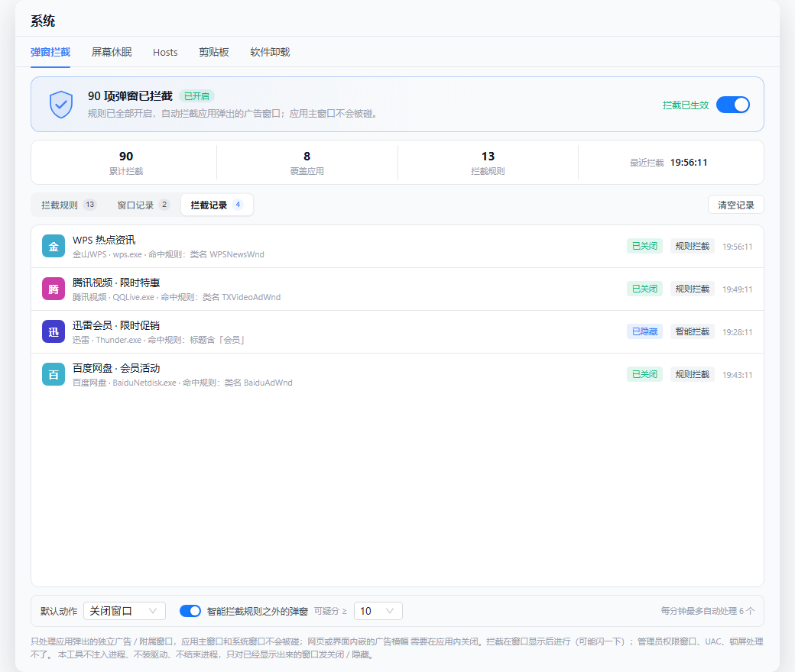
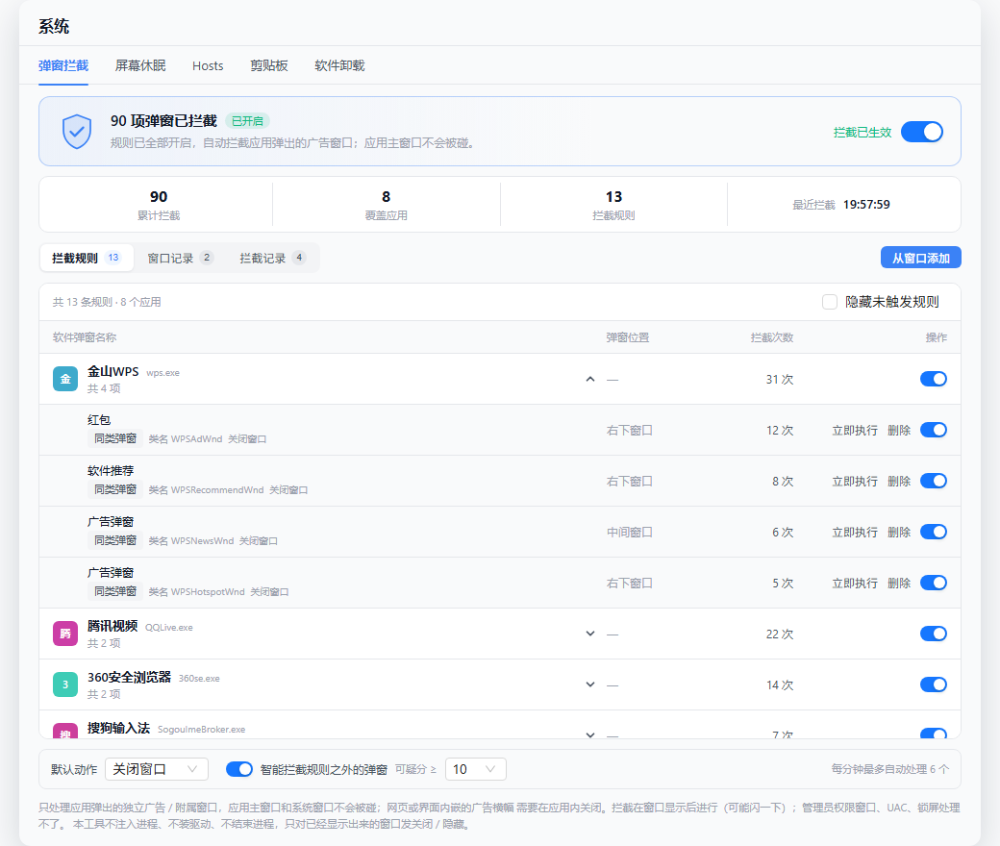
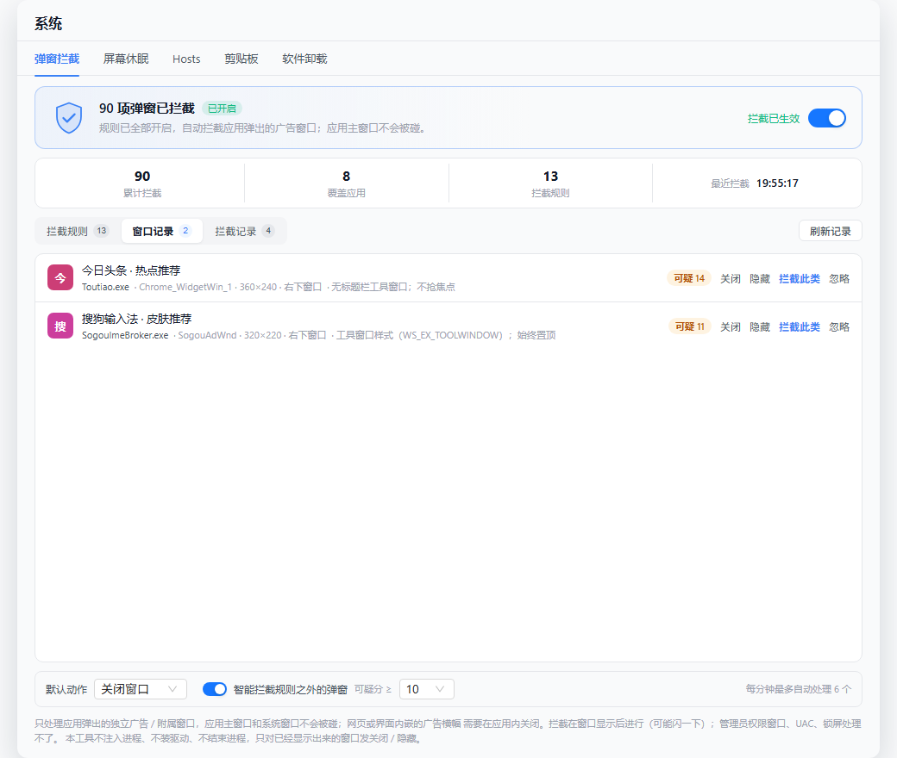
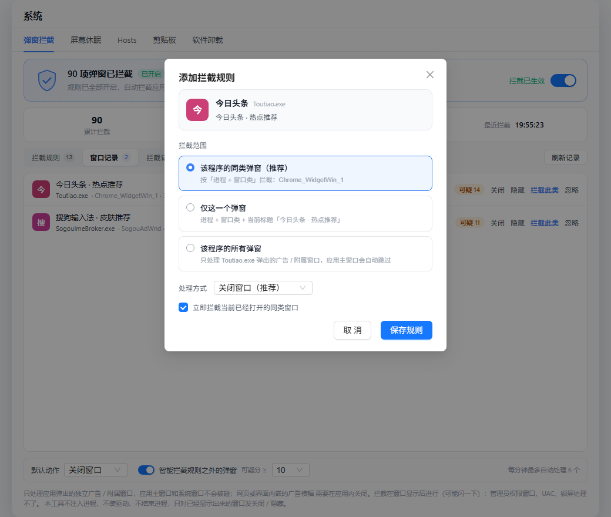
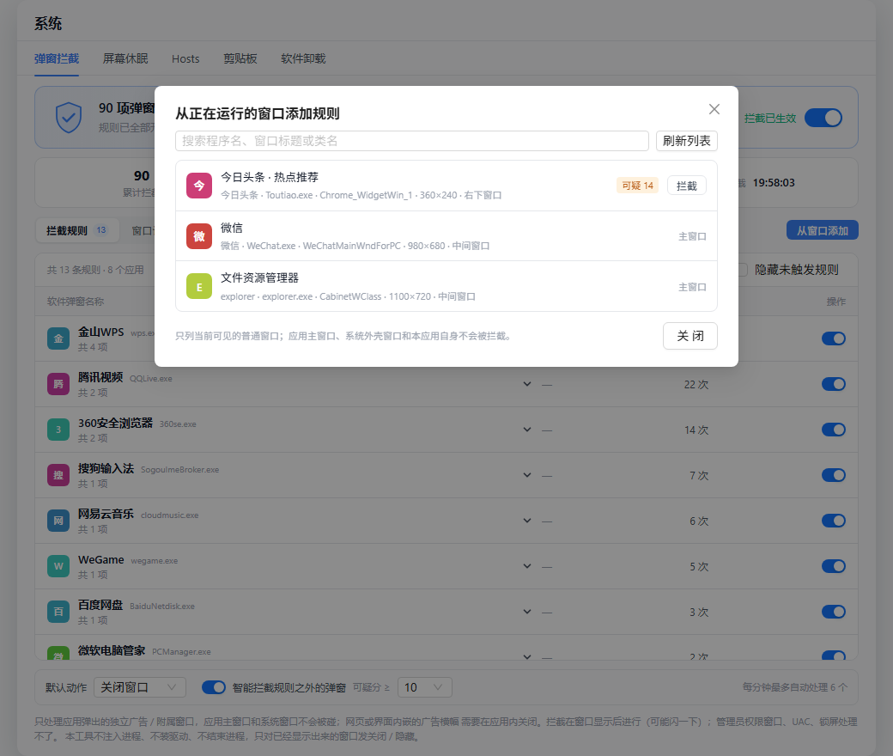

# 「系统」工具页扩展设计（屏幕休眠 / 开机自启 / 弹窗拦截 / 默认应用）

> **2026-11-07 后续调整**：用户决定去掉「开机自启」「默认应用」两个页签，前后端代码已删除；
> 实际页签为 `软件卸载 | 弹窗拦截(仅 Windows) | 屏幕休眠 | Hosts | 剪贴板`。本文 4.2、4.4 节与
> 相关测试清单仅作历史设计保留，不再对应代码。屏幕休眠页签也改成了会话式菜单（不限时 / 分钟 /
> 小时 / 自定义小时+分钟），与 Amphetamine「开启新会话」一致，4.1 节的固定四档时长已过时。

- 日期：2026-11-07
- 分支：feat/uninstaller
- 状态：设计已确认（方案 B：`cleaner` 模块内按 tab 拆子模块），实现中
- 关联：[2026-11-06-cleaner-design.md](./2026-11-06-cleaner-design.md)（软件卸载；内存占用部分已于 2026-11-07 移除）

## 1. 背景与目标

原「系统清理」工具页只有软件卸载 / 内存占用两个页签。这一版把它扩成「系统」工具页；**2026-11-07 按需求移除内存占用**（查看内存、结束进程、深度释放一并删除，卸载时也不再自动结束运行中的应用），现为软件卸载 + 四个新页签：

| 页签 | 能力 | 备注 |
| --- | --- | --- |
| 软件卸载 | 不变 | 已有 |
| 弹窗拦截 | 按应用分组的持久化规则，自动关闭应用弹出的广告 / 附属窗口 | **仅 Windows**，紧跟软件卸载；主窗口保护 |
| 屏幕休眠 | 阻止系统睡眠 / 屏幕关闭，可定时 | 参考 Amphetamine 的公开 API 做法 |
| 开机自启 | 列出开机启动项，启用 / 禁用，含本应用登录启动开关 | Windows 注册表/启动文件夹，macOS LaunchAgents + 登录项 |
| 默认应用 | 查看/修改常见文件类型的默认打开应用 | macOS 可改；Windows 只读 + 「选择默认应用」对话框 + 系统设置入口 |

非目标（本期不做）：
- 合盖不休眠（macOS `pmset disablesleep` 需 root，有残留风险）、away mode（仅 S3）
- 弹窗「自动拦截」已实现为持久化规则 + 可选智能模式；不做 DLL 注入、驱动、结束进程，也不处理嵌入应用界面的广告横幅
- Windows 静默改写 `UserChoice`（Win8+ 有哈希保护，第三方写入会被系统重置，属于破坏行为）
- 写系统级启动项（HKLM / 公共启动文件夹）——只读展示，需管理员的操作不自动触发

## 2. 信息架构

- 页面标题「系统清理」→「系统」；侧栏按钮 title/aria「清理」→「系统」；托盘菜单项「清理」→「系统」；快捷键 `⌘/Ctrl+4` 不变；内部 view key 仍为 `cleaner`（命令前缀也保持 `cleaner_*`，避免大范围改名）。
- 页签顺序：`软件卸载 | 弹窗拦截(仅 Windows) | 屏幕休眠 | 开机自启 | 默认应用`
- 每个页签独立组件，容器 `CleanerPanel.vue` 只负责页签状态与懒加载（进入页签才拉数据 / 开监听）。

## 3. 模块划分（方案 B：一个 cleaner 模块，内部按 tab 拆）

后端：

```text
src-tauri/src/cleaner/
  sleep.rs              屏幕休眠（内部 cfg 分支 / 平台函数）
  startup.rs (+ startup_macos.rs / startup_windows.rs)
  popup.rs              Windows-only 检测线程；非 Windows 返回「不支持」
  defaultapps.rs (+ defaultapps_macos.rs / defaultapps_windows.rs)
  models.rs             现有数据契约；新增类型就近放各自模块文件，避免共享文件冲突
```

命令层（每个 tab 一个文件，只做参数/错误翻译，不含业务）：

```text
src-tauri/src/commands/cleaner_sleep.rs
src-tauri/src/commands/cleaner_startup.rs
src-tauri/src/commands/cleaner_popup.rs
src-tauri/src/commands/cleaner_defaultapps.rs
```

前端（每个 tab 一套：类型 / API / composable / 组件）：

```text
src/types/{sleep,startup,popup,defaultapps}.ts
src/api/{sleep,startup,popup,defaultapps}.ts
src/composables/use{KeepAwake,Startup,Popup,DefaultApps}.ts
src/components/cleaner/{SleepPanel,StartupPanel,PopupPanel,DefaultAppsPanel}.vue
```

共享文件（`cleaner/mod.rs`、`commands/mod.rs`、`lib.rs` 的 handler 注册、`CleanerPanel.vue`、`App.vue`）由 Lead 统一改，实现者不改，避免冲突。

## 4. 功能设计

### 4.1 屏幕休眠（防休眠）

交互：开关「保持唤醒」+ 时长（15/30/60/120 分钟 / 无限）+「允许屏幕关闭」勾选（默认关，即屏幕保持常亮）+ 状态卡（已保持时长、剩余时间、当前是否阻止屏幕关闭）+ 停止。

命令：`keepawake_status` / `keepawake_start(duration_secs: Option<u64>, allow_display_sleep: bool)` / `keepawake_stop`。

- macOS：IOKit `IOPMAssertionCreateWithName`，系统断言 `PreventUserIdleSystemSleep` 常建；`allow_display_sleep=false` 时加 `PreventUserIdleDisplaySleep`。断言名固定 `ws-workbench Keep Awake`，进程退出/崩溃由系统自动回收。不需要 root、不需要 TCC。
- Windows：首版用 `SetThreadExecutionState(ES_CONTINUOUS | ES_SYSTEM_REQUIRED [| ES_DISPLAY_REQUIRED])`，由专用线程每 25 秒重新置位，停止时发信号让线程复位 `ES_CONTINUOUS` 后退出。API 面比 `PowerCreateRequest` 小，不需要管理员；代价是 `powercfg /requests` 里看不到命名请求（后续要可见性再换 `PowerCreateRequest`）。
- 定时：后端持有 `expires_at: Option<Instant>`，`std::thread` 定时器到期自动释放，`keepawake_status` 里还有一道惰性回收（定时器被系统挂起也不会残留断言）；`keepawake_status` 返回剩余秒数。
- 失败/边界：断言或电源请求创建失败返回中文错误；Windows 不拦屏保/合盖/主动睡眠，Modern Standby 下可能被挂起，UI 写明；macOS 合盖不在支持范围。
- 状态只在本进程内有效，重启应用即释放（不做登录级保活）。

**自动保持（Triggers，对齐 Amphetamine）**：页签第三张卡「自动保持唤醒」，总开关默认关；开启后可按规则自动保持：

- 规则类型（多条规则之间是「或」，任一满足即保持）：
  - `app_running`：指定进程在运行时（进程名忽略大小写、包含即匹配，可填 `Typora` / `Code`）；
  - `ac_power`：接通电源时（笔记本）；
  - `external_display`：连接外接显示器时。
- 命令：`sleep_triggers_state` / `sleep_triggers_set_armed(armed)` / `sleep_triggers_add(kind, value)` / `sleep_triggers_remove(id)` / `sleep_triggers_set_enabled(id, enabled)`。
- 实现：`cleaner/sleep/triggers.rs` 后台线程 5 秒一轮探测；进程列表用 `sysinfo`（跨平台），电源 macOS 用 `pmset -g batt`（`AC Power`）/ Windows 用 `GetSystemPowerStatus().ACLineStatus`，外接显示器 macOS 用 CoreGraphics `CGGetActiveDisplayList` 数量 > 1 / Windows 用 `GetSystemMetrics(SM_CMONITORS) > 1`。全部只读、不需要管理员权限。
- 优先级：手动开启优先——有手动会话时规则不接管；规则失效只释放「规则自己开」的会话（`Origin::Manual` / `Origin::Trigger(id)` 区分），不会误停手动会话。命中/失效时发事件 `sleep-triggers-changed`，状态卡显示「自动规则：…」。
- 持久化：`<data_dir>/sleep-triggers.json`（`armed` + 规则列表，最多 20 条），不动 AppConfig。
- 边界：规则只在应用运行期间生效（不做登录级保活、不装守护进程）；外接显示器按「活动屏幕数 > 1」判断，Sidecar/虚拟显示器也会算一块屏。

### 4.2 开机自启（启动项管理）

数据：`StartupItem { id, name, command, source, scope, enabled, can_toggle, detail }`
- `source`: `run` / `run_once` / `startup_folder` / `launch_agent` / `login_item`
- `scope`: `user` / `machine`

命令：`startup_list` / `startup_set_enabled(id, enabled)` / `startup_app_autostart_get` / `startup_app_autostart_set(enabled)`。

Windows：
- 枚举 `HKCU\...\Run`、`HKLM\...\Run`（含 `WOW6432Node` 32 位视图）、`RunOnce`（只读）、用户/公共启动文件夹。
- 启用状态读 `Explorer\StartupApproved\{Run,Run32,StartupFolder}` 的 12 字节 REG_BINARY：`02` = 启用；`03` + FILETIME = 禁用；缺省视为启用。写状态前把当前值备份到 `<data_dir>/startup-backup.json`（带时间戳，可回滚）。
- 禁用只写状态位、不删 Run 值；HKLM / 公共启动文件夹需要管理员 → `can_toggle=false` + 提示；`RunOnce` 只读。
- 本应用登录启动：写/删 `HKCU\...\Run\ws-workbench`，默认关。

macOS：
- 枚举 `~/Library/LaunchAgents/*.plist`（读 `Label`、`Program`/`ProgramArguments`、`RunAtLoad`），`/Library/LaunchAgents` 只读（需要 root 才能改）。
- 启用/禁用：`launchctl disable/enable gui/$UID/<label>` + `launchctl bootstrap/bootout gui/$UID <plist>`，只动用户域。
- 登录项：`osascript` 走 System Events 读取名称并启停；首次会触发「控制 System Events」自动化授权，被拒绝时降级为只列 LaunchAgents 并给提示（不阻塞页面）。
- 本应用登录启动：`SMAppService.mainApp`（macOS 13+）或 `~/Library/LaunchAgents/ws-workbench.plist`，默认关。

安全：只切状态不删除条目；系统范围只读；桌面文件系统只读不写。

### 4.3 弹窗拦截（仅 Windows，规则拦截 + 启发式检测）

交互（照火绒的弹窗拦截）：页签顶部总开关（默认关，开启后持久化，下次启动自动恢复）+ 「N 项弹窗已拦截」标题 + 四格统计（累计拦截 / 覆盖应用 / 拦截规则 / 最近拦截时间）+「拦截规则 | 窗口记录 | 拦截记录」三个分段页签 + 设置条（默认动作 `close` / `hide`、智能拦截开关与阈值、每分钟自动处理上限）。

- **拦截规则**：按应用分组（应用图标 / 名称 / 进程名、共 N 项、应用总开关、展开箭头）。展开后逐条显示「软件弹窗名称」（红包 / 软件推荐 / 广告弹窗）、弹窗位置（右下窗口 / 中间窗口 / 任意位置）、拦截次数、单条开关，以及「立即执行 / 删除」。顶部「共 N 条规则 · N 个应用」和火绒的「隐藏未触发规则」过滤；「从窗口添加」打开当前窗口选择器。
- **窗口记录**：没有命中规则、但特征可疑的窗口进这里；行内可直接「关闭 / 隐藏 / 拦截此类 / 忽略」。窗口一闪而过后记录仍在，用来补规则。文案和火绒一致，不再叫「可疑记录」。
- **拦截记录**：命中的历史（本次运行，最多 300 条），显示已关闭 / 已隐藏、规则拦截 / 智能拦截与时间。
- **应用总开关**：一条命令切换该进程下所有规则（`popup_app_toggle`），与单条开关并存；统计里的「N 项弹窗已拦截」是规则持久化命中数之和，不是本次运行记录数。

界面预览（示例数据，截图由真实组件渲染）：

| 拦截记录 | 拦截规则（按应用分组） | 窗口记录 |
| --- | --- | --- |
|  |  |  |

| 添加规则确认框 | 从窗口添加 |
| --- | --- |
|  |  |

命令：`popup_status` / `popup_start` / `popup_stop` / `popup_recent` / `popup_clear` / `popup_dismiss(id, action)` / `popup_ignore(process, ignored)` / `popup_ignored` / `popup_settings_get` / `popup_settings_set(settings)` / `popup_rules` / `popup_rule_add(draft, applyNow)` / `popup_rule_remove(id)` / `popup_rule_toggle(id, enabled)` / `popup_app_toggle(process, enabled)` / `popup_rule_apply(rule_id)` / `popup_windows` / `popup_app_meta(paths)`。耗时命令（`start` / `stop` / `rule_apply` / `windows` / `app_meta`）走 `spawn_blocking`，不占 Tauri 主线程。

- **规则模型**：`PopupRule { name, position, process, class_name, title, scope, action, enabled, hits, last_hit_ms }`。`name` 是火绒式短名（红包 / 软件推荐 / 广告弹窗 / 活动弹窗），`position` 是右下窗口 / 中间窗口 / 任意位置；旧规则文件缺这两个字段时加载会按标题 / 类名补全。匹配是纯函数 `rule_matches`：进程忽略大小写必须相等；`class_name` 非空时窗口类相等；`title` 非空时标题包含它（忽略大小写）；两者都空表示「该程序的所有弹窗」。`scope`（`window` / `class` / `app`）只用于展示与新增时裁剪匹配字段，因此「同类弹窗」在广告换标题 / 素材后依然命中。
- **主窗口保护（关键）**：每个进程的可见顶层窗口里，取最大的「无 owner、非工具窗口、非 NOACTIVATE、有标题、尺寸像正常窗口」的窗口标记为 `is_main`；检测线程和规则执行在匹配规则**之前**就跳过它。因此即使规则范围是「该程序的所有弹窗」（`scope=app`），也只会关掉应用弹出的广告 / 附属窗口，不会关掉应用主窗口。有 owner 的窗口天然算附属窗口，会加分并允许被拦截。限制：一个进程同时开着多个同等正常的窗口时，只保证最大的那个不被 app 规则误伤；对这类程序建议用「同类弹窗」而不是「所有弹窗」。
- **规则来源**：① 窗口记录点「拦截此类」→ 默认 `class` 范围，可改成「仅此弹窗」（加标题）或「该程序全部」（主窗口仍受保护）；② 「从窗口添加」列出当前可见顶层窗口（带进程、标题、类名、尺寸、位置、可疑分，主窗口和系统窗口标为不可拦截）挑一个；③ 同一匹配条件重复添加会合并到已有规则并重新启用，不会堆重复项。新增时可勾选「立即拦截当前已经打开的同类窗口」，后端对该规则立即扫一遍可见窗口并处理。
- **检测线程**：每 500ms `EnumWindows` 轮询可见顶层窗口（和火绒的定时器 + 枚举思路一致，API 面比 `SetWinEventHook` 小、不会被 UIPI 挡事件）。先标记主窗口，再匹配启用中的规则：命中就 `WM_CLOSE` / `SW_HIDE` 并记一条「已拦截」；同一个窗口句柄两次动作至少间隔 5 秒（防无视关闭的窗口被连环处理），同一窗口实例只记一条记录。没有命中规则才走启发式打分（`WS_EX_TOOLWINDOW` / `WS_EX_NOACTIVATE` / `WS_EX_TOPMOST`、无标题、尺寸异常、类名与标题广告线索、进程不在前台），可疑窗口用 `popup-detected` 事件推给界面。
- **窗口记录**：分数 > 0 且没有规则的窗口进「窗口记录」；窗口关闭 / 隐藏后记录自动移除（拦截记录保留作历史，最多 300 条，进程重启清空；每轮 500ms 清理已销毁窗口，避免 HWND 复用后关错窗口）。
- **智能拦截（可选，默认关）**：没有命中规则时，命中闸门才自动处理——`smart=true`、`score >= min_score`、至少两条命中原因、不在受保护进程 / 窗口类表、不在忽略名单、每分钟自动处理数未达上限（默认 6）。规则拦截不走这个闸门，因为它是用户明确的意图；主窗口闸门始终生效。
- **硬保护**：`explorer.exe` / `dwm.exe` / 任务栏 / 开始菜单 / 输入法 / 本应用等 22 个进程与 8 类外壳窗口永远不自动处理；新增规则时直接拒绝这类进程。
- **持久化**：规则存 `<data_dir>/popup-rules.json`（命中次数由检测线程最多每 10 秒懒落盘，停线程时再刷一次）；设置存 `popup-settings.json`（`popup_start` / `popup_stop` 同步总开关 `enabled`，前端传值会被忽略）；忽略名单存 `popup-ignore.json`（按进程名，运行中即时生效）。三份文件都是「写临时文件再改名」，避免写一半被读到；读取时容忍 UTF-8 BOM（PowerShell 5.1 的 `Set-Content -Encoding UTF8` 会写 BOM，旧版本曾因此把规则读成 0 条）。
- **图标与名称**：`popup_app_meta` 复用 openwith 的 PowerShell 批量图标脚本，额外读 exe 的 `FileDescription` 作展示名，按路径缓存；取不到图标时前端用进程名 + 首字母色块兜底，不影响功能。
- **边界（写进 UI 说明）**：只能显示后处理（500ms 轮询，弹窗会闪一下）；UIPI 下关不掉管理员窗口；UAC / 锁屏不可见；**网页或应用界面内嵌的广告横幅不是独立窗口，这套方案管不了**，需要在应用内关闭；不注入、不驱动、不杀进程；同一程序不同窗口类需要分别加规则。
- 非 Windows：模块编译 stub，命令返回「仅 Windows 支持」；前端用 `platform.is_windows` 隐藏页签。

### 4.4 默认应用

交互：常用类型列表（扩展名 → 当前默认应用 → 「更换」），Windows 额外提供「选择默认应用…」与「打开系统默认应用设置」。

命令：`defaultapps_list` / `defaultapps_candidates(extension)` / `defaultapps_set(extension, app_id)` / `defaultapps_reveal_settings` / `defaultapps_open_with(extension)`。

- macOS：扩展名 → UTI（`UTTypeCreatePreferredIdentifierForTag(kUTTagClassFilenameExtension)`）→ 当前 handler（`LSCopyDefaultRoleHandlerForContentType`）→ 改（`LSSetDefaultRoleHandlerForContentType(kLSRolesAll, bundle_id)`）。候选应用 = `/Applications`、`~/Applications` 里能打开该 UTI 的 bundle（`LSCopyAllRoleHandlersForContentType` + `LSCopyApplicationURLsForBundleIdentifier`）。不需要 TCC/root。
- Windows：只读展示扩展名当前关联（`HKCU\...\Explorer\FileExts\<ext>\UserChoice` 的 `ProgId` → `HKCR\<ProgId>\shell\open\command`）；「选择默认应用…」用 `rundll32 shell32.dll,OpenAs_RunDLL <临时文件>` 打开系统「打开方式」对话框（用户勾选「始终使用」即完成设置）；「打开系统设置」用 `ms-settings:defaultapps`。**不静默写 UserChoice**（Win8+ 哈希保护）。
- 常见类型首批：`.txt .md .pdf .png .jpg .mp4 .mp3 .zip .html .json .csv .docx .xlsx .pptx`。
- 错误：bundle 解析失败 / 没有可用应用 / 系统接口拒绝时返回中文提示并保持原值。

## 5. 验证计划

- 单测：启动项解析与 StartupApproved 编解码（正/反例）、弹窗启发式评分（构造特征组合）、防休眠状态机与定时（不依赖平台 API 的部分）、默认应用类型表与路径归一化。
- macOS 实机：`pmset -g assertions` 断言出现/消失；临时 LaunchAgent 上 enable/disable 后清理；`LSSetDefaultRoleHandlerForContentType` 改一个测试扩展名再改回；备份 JSON 内容断言。
- Windows：`cargo xwin check` + 实机验收清单（启动项状态位、`powercfg /requests`、弹窗检测、OpenAs 对话框）。
- 前端：`pnpm build` + Tabbit mock 渲染截图（四个新页签）。

### 5.1 已执行（2026-11-07，macOS 14 真机）

| 检查 | 命令 | 结果 |
| --- | --- | --- |
| Rust 全量单测 | `cargo test --lib` | 382 passed / 0 failed / 7 ignored（跨平台单测 + 手动探针） |
| 电源断言真实性 | `cargo test --lib cleaner::sleep::tests::manual_assertion_shows_in_pmset -- --ignored` | `pmset -g assertions` 里出现 `ws-workbench Keep Awake`，`PreventUserIdleSystemSleep` + `PreventUserIdleDisplaySleep` 各一条，停止后消失 |
| 启动项枚举 | `... cleaner::startup::tests::manual_list_real_items --ignored` | 本机 22 条（用户 LaunchAgents 可切、`/Library` 只读带原因、禁用时间反解正常） |
| 默认应用读取 | `... cleaner::defaultapps::tests::manual_list_real_defaults --ignored` | 14 种类型全为真实 handler；`.txt` 候选 18 个（含 `~/Applications`） |
| macOS 编译 | `cargo check` | 通过，仅 3 条 vpn 既有 warning |
| Windows 交叉编译 | `cargo xwin check --target x86_64-pc-windows-msvc` | 通过，0 error（含拦截模式线程、自动保持电源/显示器探测与 win32 调用） |
| 前端构建 | `pnpm build` | 通过（vue-tsc + vite） |
| 应用启动 | `pnpm tauri dev` | 正常启动，托盘快捷面板创建成功，无 panic |

未做（环境限制）：真实安装包（Program Files / 管理员权限路径）验收；真实改动系统默认应用（避免动用户既有文件关联，只验证读与候选）；弹窗检测只在 Windows 有效，已用 Windows 实机跑通主窗口保护。

### 5.2 弹窗拦截（2026-11-11，Windows 实机）

| 检查 | 命令 / 操作 | 结果 |
| --- | --- | --- |
| 弹窗模块单测 | `cargo test --lib cleaner::popup` | 31 passed / 0 failed |
| 后端编译 | `cargo check --lib` | 通过（仅既有 warning） |
| 前端类型检查 | `pnpm exec vue-tsc --noEmit` | 通过 |
| 前端构建 | `pnpm build` | 通过（vue-tsc + vite） |
| 主窗口保护实机 | 规则 `scope=app`（powershell.exe）+ 900×600 主窗口 + 420×260 owner/工具窗口广告 | 广告窗口 0.44s 内关闭；主窗口保持打开；规则 hits 从 0 持久化为 1 |
| 旧规则 / BOM 兼容 | `cargo test --lib cleaner::popup::tests::old_rules_get_name_and_position_backfilled`、`json_with_utf8_bom_is_accepted` | 通过（旧规则补 name/position；带 BOM 的 JSON 可读） |


## 6. 已知限制

- 内存占用功能已于 2026-11-07 移除：不再展示系统内存、结束进程与深度释放；卸载流程改为只调用系统卸载器 / 移入废纸篓，不再先结束运行中的应用（应用在运行时由卸载器自行提示，macOS 运行中的实例会随 bundle 移入废纸篓、持续到用户退出应用）。

- 屏幕休眠：只防空闲睡眠/关屏；不拦屏保（macOS 屏幕断言会压制屏保）、合盖、主动睡眠。
- 开机自启：Windows `StartupApproved` 格式无官方文档，按 Win10/11 观察实现，写坏了有备份可回滚；macOS 登录项依赖自动化授权。
- 弹窗拦截：只处理应用弹出的独立广告 / 附属窗口，应用主窗口会被自动跳过；网页或应用界面内嵌的广告横幅不是独立窗口，这套方案管不了。按窗口特征识别，极端情况下仍可能误判；对管理员权限窗口（UIPI）发关闭会失败，不计命中。
- 默认应用：Windows 不能静默改（系统限制），只能引导；macOS 用的 LaunchServices API 已标记 deprecated，但仍是当前唯一可行方式。
